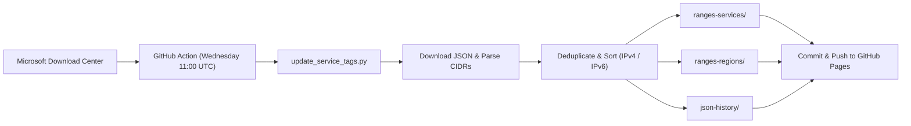

# Azure IP Ranges & Service Tags Automation

> **Live Hub & Direct Downloads:** [https://leoescarpellin.github.io/azureIPranges/](https://leoescarpellin.github.io/azureIPranges/)  
> **Source:** [Microsoft Azure IP Ranges and Service Tags – Public Cloud](https://www.microsoft.com/en-us/download/details.aspx?id=56519)

An automated utility for downloading, deduplicating, sorting, and publishing Microsoft Azure service and regional IP ranges into clean plain-text CIDR lists.

Designed for direct integration with firewall aliases and dynamic network lists:
* **pfSense** (`URL Table (IPs)` Aliases)
* **OPNsense** (`URL Table (IPs)` Aliases)
* **Palo Alto Networks** (`External Dynamic Lists - EDL`)
* **MikroTik RouterOS** (`Address Lists`)
* **Fortinet FortiGate** (`External Threat Feeds`)
* **Cisco ASA / Firepower** (`Dynamic Objects / Security Intelligence`)

---

## Key Features

* **Strict Deduplication:** Eliminates overlapping and duplicate prefixes generated between global service tags and regional tags.
* **Canonical CIDR Sorting:** Prefixes are sorted numerically by base address and subnet mask length.
* **Protocol Separation:** Every service and region is published in three formats:
  * `<name>.ipv4.txt` — IPv4 only (prevents family mismatch in pfSense / OPNsense rules)
  * `<name>.ipv6.txt` — IPv6 only
  * `<name>.txt` — Combined (IPv4 followed by IPv6)
* **Organized by Service:** 100+ individual services available in `ranges-services/` (e.g., `AzureStorage`, `AzureSQL`, `AzureCloud`, `AzureFrontDoor.Frontend`).
* **Organized by Region:** 78 Azure regions available in `ranges-regions/` (e.g., `brazilsouth`, `eastus`, `westeurope`), aggregating all IP ranges allocated to that region.
* **Static JSON Mirror:** Provides a permanent uncompressed link to the latest JSON without needing to scrape Microsoft's download center: [`json-history/ServiceTags_Public.json`](https://leoescarpellin.github.io/azureIPranges/json-history/ServiceTags_Public.json).
* **Storage Optimization:** Historical weekly JSON files are maintained within a rolling 12-week retention window and compressed with Gzip (`.json.gz`), keeping the Git repository lightweight (<15 MB total).
* **Automated Weekly Updates:** Powered by GitHub Actions running every Wednesday at 11:00 UTC.

---

## Directory & URL Structure

| Directory | Description | URL Pattern |
| :--- | :--- | :--- |
| **`ranges-services/`** | Service-specific IP lists (100+ services) | `https://leoescarpellin.github.io/azureIPranges/ranges-services/<Service>.ipv4.txt` |
| **`ranges-regions/`** | Region-wide aggregated IP lists (78 regions) | `https://leoescarpellin.github.io/azureIPranges/ranges-regions/<region>.ipv4.txt` |
| **`json-history/`** | Historical weekly Microsoft JSON dumps and static mirror | `https://leoescarpellin.github.io/azureIPranges/json-history/ServiceTags_Public.json` |

---

## Firewall Integration Guides

### 1. pfSense (URL Table Aliases)

1. Open pfSense WebGUI and go to **Firewall &rarr; Aliases &rarr; IP**.
2. Click **Add**.
3. Configure the alias:
   * **Name:** `Azure_Storage_IPv4`
   * **Type:** `URL Table (IPs)`
   * **URL:** `https://leoescarpellin.github.io/azureIPranges/ranges-services/AzureStorage.ipv4.txt`
   * **Update Frequency:** `1` day (or `7` days)
4. Click **Save** and **Apply Changes**.
5. Use the alias as **Source** or **Destination** in your Firewall Rules.

> **Tip:** Always use `.ipv4.txt` for IPv4 rules and `.ipv6.txt` for IPv6 rules to prevent pf table family conflicts.

---

### 2. OPNsense (URL Table Aliases)

1. Navigate to **Firewall &rarr; Aliases** and click **+** (Add).
2. Configure:
   * **Enabled:** Checked
   * **Name:** `Azure_BrazilSouth`
   * **Type:** `URL Table (IPs)`
   * **Content:** `https://leoescarpellin.github.io/azureIPranges/ranges-regions/brazilsouth.ipv4.txt`
   * **Refresh Frequency:** `1` day
3. Save and apply. OPNsense creates an in-memory table updated automatically by cron.

---

### 3. Palo Alto Networks (External Dynamic List - EDL)

1. Navigate to **Objects &rarr; External Dynamic Lists**.
2. Click **Add**.
3. Set **Type** to `IP List`.
4. Enter the Source URL:
   `https://leoescarpellin.github.io/azureIPranges/ranges-services/AzureStorage.txt` (or `.ipv4.txt`)
5. Set the Repeat frequency (e.g. `Daily` or `Weekly`).
6. Reference the EDL object inside Security Policy Rules.

---

### 4. MikroTik RouterOS

Fetch and populate an Address List dynamically via scheduled script:

```routeros
/tool fetch url="https://leoescarpellin.github.io/azureIPranges/ranges-regions/brazilsouth.ipv4.txt" dst-path="azure_brazil.txt"
:local content [/file get azure_brazil.txt contents]
:local lineEnd 0
:local line ""
/ip firewall address-list remove [find list="Azure_Brazil"]
:while ([:len $content] > 0) do={
    :set lineEnd [:find $content "\n"]
    :if ([:len $lineEnd] = 0) do={ :set lineEnd [:len $content] }
    :set line [:pick $content 0 $lineEnd]
    :set content [:pick $content ($lineEnd + 1) [:len $content]]
    :if ([:len $line] > 0) do={
        /ip firewall address-list add list="Azure_Brazil" address=$line timeout=1d
    }
}
/file remove azure_brazil.txt
```

---

### 5. Fortinet FortiGate (External Threat Feeds)

1. Navigate to **Security Fabric &rarr; Fabric Connectors** (or **External Connectors**).
2. Click **Create New** and select **Threat Feeds &rarr; IP Address**.
3. Configure:
   * **Name:** `Azure_Storage_Feed`
   * **URL:** `https://leoescarpellin.github.io/azureIPranges/ranges-services/AzureStorage.ipv4.txt`
   * **Refresh Rate:** `Daily`
4. Click **OK** and use the connector in **Policy & Objects &rarr; Firewall Policy**.

---

### 6. Cisco Firepower / ASA

1. In Firepower Management Center (FMC), navigate to **Objects &rarr; Object Management &rarr; Security Intelligence &rarr; Network Lists and Feeds**.
2. Click **Add Network Lists and Feeds**:
   * **Name:** `Azure_Services_Feed`
   * **Type:** `Feed`
   * **Feed URL:** `https://leoescarpellin.github.io/azureIPranges/ranges-services/AzureStorage.ipv4.txt`
   * **Update Frequency:** `Daily`
3. Save and deploy to your FTD devices.

---

## Automation Workflow

The repository is refreshed automatically via **GitHub Actions** ([`.github/workflows/update.yml`](.github/workflows/update.yml)):



---

## Local Development

1. Clone repository:
   ```bash
   git clone https://github.com/leoescarpellin/azureIPranges.git
   cd azureIPranges
   ```

2. Install dependencies:
   ```bash
   pip install -r requirements.txt
   ```

3. Run the generator script:
   ```bash
   python update_service_tags.py
   ```

---

## Acknowledgments

Special thanks to [Enzo Gautier](https://github.com/enzo-g) and the original [enzo-g/azureIPranges](https://github.com/enzo-g/azureIPranges) repository, which served as the foundation and initial inspiration for this project.

---

## Disclaimer

This repository and its contents are provided "AS IS" without warranty of any kind. Microsoft updates these IP ranges on a weekly basis. Verify the ranges against your network requirements prior to production deployment.

---

## License

This project is open-source under the [MIT License](LICENSE).
